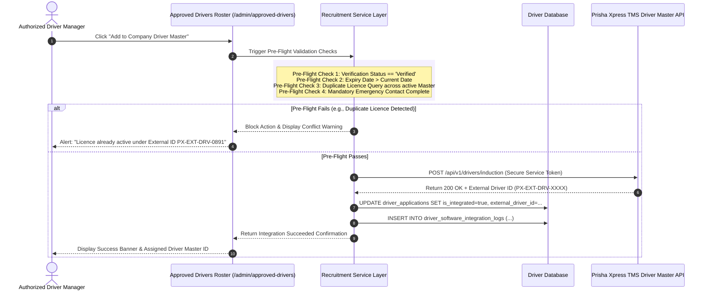

# Prisha Xpress Pvt. Ltd.
## Company Software Integration Architecture & Master Induction Guidelines

**Target System:** Prisha Xpress Driver Master TMS ERP  
**Admin Workspace:** `/admin/approved-drivers`  
**Execution Authority:** Authorized Driver Manager (`driver_manager`) & Super Admin (`super_admin`) only.  

---

### 1. Integration Boundary Philosophy

To maintain enterprise data hygiene and prevent spurious candidate records from corrupting live transport operations:

> **Core Principle:**  
> A candidate submitting an application through the public website is **NEVER** created as an active employee or driver in the company's core ERP software.  
> Candidates remain strictly inside the recruitment staging database (`driver_applications`) until fully vetted, approved, and explicitly integrated by an authorized manager.

---

### 2. Integration Workflow & Pre-Flight Checks

---

### 3. Pre-Flight Validation Rules

Before an approved driver can be pushed to the company Driver Master TMS:
1. **Document Verification Check:** `verification_status` must strictly equal `'Verified'`. Drivers with `'Pending'`, `'Unclear'`, or `'Invalid'` are unconditionally rejected.
2. **Duplicate Record Detection:** The system executes an exact uppercase, whitespace-normalized string comparison on `licence_number` against all active drivers in the system. If an existing match is found, integration is aborted with an informative alert.
3. **Licence Expiry Guard:** The licence expiry date must be strictly in the future.
4. **Mandatory Identity Completeness:** Full legal name, verified mobile number, emergency contact relative, and primary vehicle class must be populated.

---

### 4. Handling Unconfigured or Offline API Environments

In development, staging, or offline environments where live corporate TMS API credentials (`PRISHA_TMS_API_KEY`) are not configured:
- The system **does not fabricate successful external handshakes**.
- The interface displays `"Integration Not Configured"`.
- The driver remains in the `Approved – Ready for Company Software` state without misleading the user.
- Staged mock induction is clearly labeled as simulated with simulated audit log entries.

---

### 5. Integration Log Record Structure

Every induction call produces an immutable audit record in `driver_software_integration_logs`:
- **`id`**: Unique UUID.
- **`driver_application_id`**: Foreign key to `driver_applications`.
- **`integration_status`**: `'SUCCESS'` | `'FAILED'` | `'NOT_CONFIGURED'`.
- **`external_driver_id`**: Unique enterprise driver code (e.g. `PX-EXT-DRV-0891`).
- **`external_system_name`**: `'Prisha Xpress Driver Master TMS ERP'`.
- **`initiated_by`**: Name and role of the executing administrator.
- **`error_message`**: Null on success; full error diagnostic on failure.
- **`created_at`**: ISO 8601 UTC timestamp.
