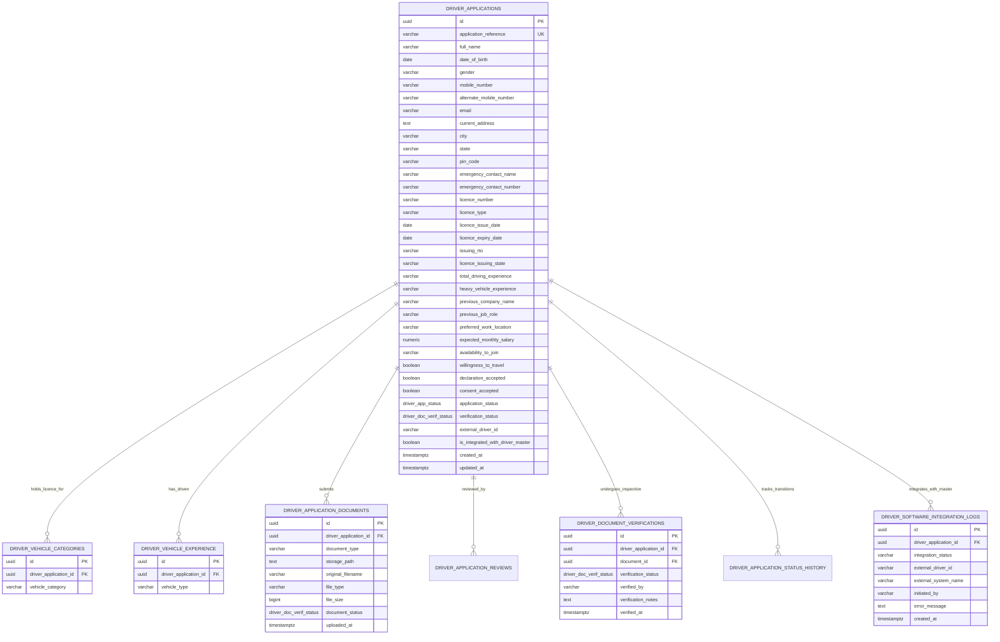

# Prisha Xpress Pvt. Ltd.
## Module B: Driver Registration Database Architecture

**Module Scope:** Heavy Commercial Vehicle Drivers, Long-Haul Truck Captains, Trailer & Container Operators  
**Target Enterprise System:** Prisha Xpress Driver Master TMS ERP  
**Reference Format:** `PX-DRV-2026-XXXX`  
**Storage Path:** `driver-application-documents/{reference}/`  

---

### 1. Relational Entity Relationship Diagram

---

### 2. Table Specifications

#### 2.1 `driver_applications`
- **`id`** (`UUID`, Primary Key, `DEFAULT uuid_generate_v4()`)
- **`application_reference`** (`VARCHAR(50)`, Unique, Not Null, generated via `driver_app_ref_seq`). Example: `PX-DRV-2026-0112`.
- **`full_name`** (`VARCHAR(255)`, Not Null): Name as printed on driving licence.
- **`date_of_birth`** (`DATE`, Not Null): Used to verify minimum age for commercial transport license.
- **`gender`** (`VARCHAR(20)`, Not Null): 'Male' | 'Female' | 'Other'.
- **`mobile_number`** (`VARCHAR(20)`, Not Null): Primary mobile for trip dispatch.
- **`alternate_mobile_number`** (`VARCHAR(20)`): Secondary contact.
- **`email`** (`VARCHAR(255)`): Optional driver email.
- **`current_address`** (`TEXT`, Not Null): Residential address.
- **`city`**, **`state`**, **`pin_code`** (`VARCHAR`, Not Null).
- **`emergency_contact_name`** (`VARCHAR(255)`, Not Null): Next of kin / family contact.
- **`emergency_contact_number`** (`VARCHAR(20)`, Not Null): Highway emergency phone.
- **`licence_number`** (`VARCHAR(100)`, Not Null): Official Indian driving licence number (e.g. `MH14 20120045612`).
- **`licence_type`** (`VARCHAR(50)`, Not Null): Commercial Heavy Transport (TRANS), HGMV, etc.
- **`licence_issue_date`**, **`licence_expiry_date`** (`DATE`, Not Null): Validated by database constraint `CHECK (licence_expiry_date > licence_issue_date)`.
- **`issuing_rto`** (`VARCHAR(100)`, Not Null): Regional Transport Office authority.
- **`licence_issuing_state`** (`VARCHAR(100)`, Not Null): Indian state of issuance.
- **`total_driving_experience`** (`VARCHAR(50)`, Not Null): Overall driving years.
- **`heavy_vehicle_experience`** (`VARCHAR(50)`, Not Null): Heavy transport years.
- **`previous_company_name`**, **`previous_job_role`** (`VARCHAR`): Past transporter details.
- **`preferred_work_location`** (`VARCHAR(150)`, Not Null): Route preference (e.g. Pune–Surat corridor).
- **`expected_monthly_salary`** (`NUMERIC(10, 2)`): Monthly payout expectation in INR.
- **`availability_to_join`** (`VARCHAR(50)`, Not Null): 'Immediate', 'Within 7 Days', etc.
- **`willingness_to_travel`** (`BOOLEAN`, Not Null, Default: `true`): Long-haul clearance.
- **`declaration_accepted`**, **`consent_accepted`** (`BOOLEAN`, Not Null, Default: `false`).
- **`application_status`** (`driver_app_status`, Not Null, Default: `'Submitted'`):
  - `'Submitted'`
  - `'Pending Verification'`
  - `'Information Required'`
  - `'Under Review'`
  - `'Approved – Ready for Company Software'`
  - `'Rejected'`
  - `'Adding to Company Software'`
  - `'Added to Company Software'`
  - `'Integration Failed'`
- **`verification_status`** (`driver_doc_verif_status`, Not Null, Default: `'Pending'`):
  - `'Pending'`
  - `'Verified'`
  - `'Unclear'`
  - `'Invalid'`
- **`external_driver_id`** (`VARCHAR(100)`): Generated upon successful induction into Prisha Xpress Driver Master TMS (e.g., `PX-EXT-DRV-0891`).
- **`is_integrated_with_driver_master`** (`BOOLEAN`, Not Null, Default: `false`).
- **`created_at`**, **`updated_at`** (`TIMESTAMPTZ`, Not Null, Default: `NOW()`).

#### 2.2 `driver_vehicle_categories`
- **`id`** (`UUID`, Primary Key, `DEFAULT uuid_generate_v4()`)
- **`driver_application_id`** (`UUID`, FK referencing `driver_applications(id)` on cascade delete)
- **`vehicle_category`** (`VARCHAR(100)`, Not Null): `'LMV'`, `'HMV'`, `'HGMV'`, `'Transport Vehicle'`, `'Trailer / Multi-Axle'`, `'Container Vehicle'`.

#### 2.3 `driver_vehicle_experience`
- **`id`** (`UUID`, Primary Key, `DEFAULT uuid_generate_v4()`)
- **`driver_application_id`** (`UUID`, FK referencing `driver_applications(id)` on cascade delete)
- **`vehicle_type`** (`VARCHAR(100)`, Not Null): Specific models driven (BharatBenz 2823R, Tata Signa, Ashok Leyland 5525).

#### 2.4 `driver_application_documents`
- **`id`** (`UUID`, Primary Key, `DEFAULT uuid_generate_v4()`)
- **`driver_application_id`** (`UUID`, FK referencing `driver_applications(id)` on cascade delete)
- **`document_type`** (`VARCHAR(50)`, Not Null): `'driving_licence'`, `'recent_photograph'`, `'address_proof'`, `'resume'`, `'experience_certificate'`, `'pan_card'`.
- **`storage_path`** (`TEXT`, Not Null): Private encrypted path in `driver-application-documents`.
- **`original_filename`**, **`file_type`**, **`file_size`** (`VARCHAR`/`BIGINT`, Not Null).
- **`document_status`** (`driver_doc_verif_status`, Not Null, Default: `'Pending'`).
- **`uploaded_at`** (`TIMESTAMPTZ`, Not Null, Default: `NOW()`).

#### 2.5 `driver_document_verifications`
- **`id`** (`UUID`, Primary Key, `DEFAULT uuid_generate_v4()`)
- **`driver_application_id`** (`UUID`, FK referencing `driver_applications(id)` on cascade delete)
- **`document_id`** (`UUID`, FK referencing `driver_application_documents(id)` on cascade delete)
- **`verification_status`** (`driver_doc_verif_status`, Not Null).
- **`verified_by`** (`VARCHAR(255)`, Not Null): Verification Officer name.
- **`verification_notes`** (`TEXT`): Remarks on RTO stamps, serial number legibility.
- **`verified_at`** (`TIMESTAMPTZ`, Not Null, Default: `NOW()`).

#### 2.6 `driver_software_integration_logs`
- **`id`** (`UUID`, Primary Key, `DEFAULT uuid_generate_v4()`)
- **`driver_application_id`** (`UUID`, FK referencing `driver_applications(id)` on cascade delete)
- **`integration_status`** (`VARCHAR(50)`, Not Null): `'SUCCESS'`, `'FAILED'`, `'PENDING'`, `'NOT_CONFIGURED'`.
- **`external_driver_id`** (`VARCHAR(100)`): TMS assigned Driver ID.
- **`external_system_name`** (`VARCHAR(255)`, Not Null): `'Prisha Xpress Driver Master TMS ERP'`.
- **`initiated_by`** (`VARCHAR(255)`, Not Null): Authorized Driver Manager.
- **`error_message`** (`TEXT`): Failure reason if API handshake fails.
- **`created_at`** (`TIMESTAMPTZ`, Not Null, Default: `NOW()`).

---

### 3. Data Integrity & Compliance Constraints
1. **Licence Date Order Check:** `CHECK (licence_expiry_date > licence_issue_date)` enforced at database engine level.
2. **No Aadhaar Storage:** Default schema explicitly excludes Aadhaar number and biometric data to comply with Aadhaar Act 2016 and Indian data privacy standards.
3. **No Automatic Official Induction:** A new record inserted into `driver_applications` remains strictly a recruitment candidate. Official company master records are only modified when an authorized driver manager executes the integration transaction.
