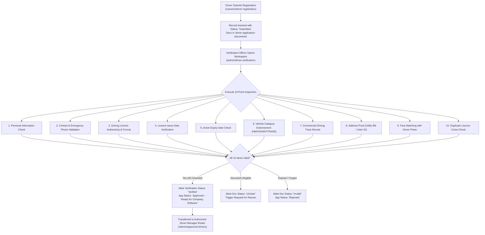

# Prisha Xpress Pvt. Ltd.
## Driver Document Verification Workflow & Standard Operating Procedure (SOP)

**Operating Unit:** Prisha Xpress Document Verification Cell (Pune HQ & Regional Service Stations)  
**Workspace Route:** `/admin/driver-verification`  
**Applicability:** Commercial vehicle drivers applying for interstate container, trailer, and heavy truck operations.  

---

### 1. 10-Point Verification Checklist Protocol

Every commercial driver registered through the portal must undergo the standard 10-point inspection protocol before status can be advanced to *Approved – Ready for Company Software*:

---

### 2. Document Status Definitions & Actions

| Document Status | Operational Meaning | Action by Verification Officer | Candidate Impact |
| :--- | :--- | :--- | :--- |
| **Pending** | Default initial state upon submission. | Review high-resolution scan in preview pane. | Under routine queue processing. |
| **Verified** | Verified legible, authentic, stamped by authorized RTO, and within active validity. | Log verification notes and mark green check. | Counts toward driver final approval threshold. |
| **Unclear** | Image blurred, corners cut off, or serial number illegible. | Mark amber warning with specific replacement note (e.g., *"Reverse side showing HGMV stamp is blurred"*). | Applicant notified to upload rescan. |
| **Invalid** | Fake watermark, expired validity without grace receipt, or non-commercial private badge only. | Mark red rejection with formal reason. | Application flagged; status updated to *Rejected*. |

---

### 3. Verification Governance & Anti-Impersonation Rules
1. **No Unsubstantiated Government Claims:** The platform does not claim automated government Parivahan Sarathi API authentication without an authorized contracted API integration. All checks are recorded as manual physical and documental checks by named company verification officers.
2. **Mandatory Dual-Signoff:**
   - Step 1: Verification Officer certifies documents at `/admin/driver-verification`.
   - Step 2: Driver Manager executes final TMS induction at `/admin/approved-drivers`.
3. **Audit Trail Logging:** Every document status change creates an entry in `driver_document_verifications` and `driver_application_status_history` capturing reviewer name, timestamp, and notes.
