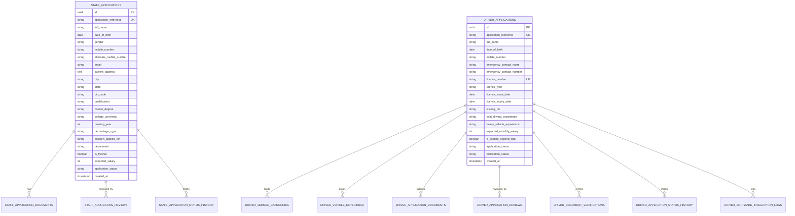

# PRISHA XPRESS PVT. LTD.
## Recruitment Database Schema & Decoupling Architecture

**Company:** Prisha Xpress Pvt. Ltd. (`CIN: U49231PN2023PTC225810`)  
**Headquarters:** Pune, Maharashtra, India  
**Architecture Model:** Strictly decoupled relational schema with independent table namespaces for Staff (`staff_*`) and Driver (`driver_*`) records.

---

### 1. Database Architecture & Complete Namespace Isolation

To ensure privacy, regulatory compliance with the Indian Motor Vehicles Act, and strict access boundaries between corporate HR and commercial fleet operations, **Prisha Xpress Pvt. Ltd.** implements a dual-namespace architecture:

| Domain | Namespace Prefix | Primary Table | Document Storage Bucket |
| :--- | :--- | :--- | :--- |
| **Module A: Staff Recruitment** | `staff_` | `staff_applications` | `staff-application-documents` |
| **Module B: Driver Registration** | `driver_` | `driver_applications` | `driver-application-documents` |

Staff applications and Driver registrations are **never joined** or colocated in generic user tables. Foreign keys link strictly within their respective domains.

---

### 2. Entity-Relationship Model



---

### 3. Detailed Table Definitions (SQL DDL)

#### A. Staff Recruitment System (`staff_*`)

```sql
-- 1. Staff Applications Master Table
CREATE TABLE public.staff_applications (
    id UUID PRIMARY KEY DEFAULT gen_random_uuid(),
    application_reference VARCHAR(32) NOT NULL UNIQUE,
    full_name VARCHAR(255) NOT NULL,
    date_of_birth DATE NOT NULL,
    gender VARCHAR(20) NOT NULL,
    mobile_number VARCHAR(15) NOT NULL,
    alternate_mobile_number VARCHAR(15),
    email VARCHAR(255) NOT NULL,
    current_address TEXT NOT NULL,
    city VARCHAR(100) NOT NULL,
    state VARCHAR(100) NOT NULL,
    pin_code VARCHAR(10) NOT NULL,
    qualification VARCHAR(100) NOT NULL,
    course_degree VARCHAR(255) NOT NULL,
    specialization VARCHAR(255),
    college_university VARCHAR(255) NOT NULL,
    passing_year INTEGER NOT NULL CHECK (passing_year BETWEEN 1980 AND 2030),
    percentage_cgpa VARCHAR(50) NOT NULL,
    additional_qualification TEXT,
    position_applied_for VARCHAR(255) NOT NULL,
    department VARCHAR(100) NOT NULL,
    preferred_location VARCHAR(255) NOT NULL,
    employment_type VARCHAR(50) NOT NULL,
    is_fresher BOOLEAN NOT NULL DEFAULT FALSE,
    total_experience VARCHAR(50),
    previous_company VARCHAR(255),
    previous_job_role VARCHAR(255),
    previous_salary VARCHAR(100),
    key_skills TEXT,
    notice_period VARCHAR(50),
    expected_salary NUMERIC(12, 2) NOT NULL DEFAULT 0,
    availability_to_join VARCHAR(50),
    additional_skills TEXT,
    additional_message TEXT,
    declaration_accepted BOOLEAN NOT NULL DEFAULT FALSE,
    consent_accepted BOOLEAN NOT NULL DEFAULT FALSE,
    privacy_accepted BOOLEAN NOT NULL DEFAULT FALSE,
    application_status VARCHAR(50) NOT NULL DEFAULT 'Submitted',
    created_at TIMESTAMPTZ NOT NULL DEFAULT timezone('utc'::text, now()),
    updated_at TIMESTAMPTZ NOT NULL DEFAULT timezone('utc'::text, now())
);

-- 2. Staff Application Documents
CREATE TABLE public.staff_application_documents (
    id UUID PRIMARY KEY DEFAULT gen_random_uuid(),
    staff_application_id UUID NOT NULL REFERENCES public.staff_applications(id) ON DELETE CASCADE,
    document_type VARCHAR(50) NOT NULL, -- 'resume', 'educational_certificate', 'experience_certificate', 'professional_certification', 'photograph'
    storage_path TEXT NOT NULL,
    original_filename VARCHAR(255) NOT NULL,
    file_type VARCHAR(100) NOT NULL,
    file_size BIGINT NOT NULL,
    uploaded_at TIMESTAMPTZ NOT NULL DEFAULT timezone('utc'::text, now())
);

-- 3. Staff Application Reviews
CREATE TABLE public.staff_application_reviews (
    id UUID PRIMARY KEY DEFAULT gen_random_uuid(),
    staff_application_id UUID NOT NULL REFERENCES public.staff_applications(id) ON DELETE CASCADE,
    reviewer_id UUID NOT NULL,
    reviewer_name VARCHAR(255) NOT NULL,
    review_status VARCHAR(50) NOT NULL,
    reviewer_comments TEXT NOT NULL,
    interview_date TIMESTAMPTZ,
    rating INTEGER CHECK (rating BETWEEN 1 AND 5),
    reviewed_at TIMESTAMPTZ NOT NULL DEFAULT timezone('utc'::text, now())
);

-- 4. Staff Application Status History
CREATE TABLE public.staff_application_status_history (
    id UUID PRIMARY KEY DEFAULT gen_random_uuid(),
    staff_application_id UUID NOT NULL REFERENCES public.staff_applications(id) ON DELETE CASCADE,
    previous_status VARCHAR(50) NOT NULL,
    new_status VARCHAR(50) NOT NULL,
    changed_by VARCHAR(255) NOT NULL,
    reason TEXT,
    created_at TIMESTAMPTZ NOT NULL DEFAULT timezone('utc'::text, now())
);
```

---

#### B. Commercial Driver Registration System (`driver_*`)

```sql
-- 1. Driver Applications Master Table
CREATE TABLE public.driver_applications (
    id UUID PRIMARY KEY DEFAULT gen_random_uuid(),
    application_reference VARCHAR(32) NOT NULL UNIQUE,
    full_name VARCHAR(255) NOT NULL,
    date_of_birth DATE NOT NULL,
    gender VARCHAR(20) NOT NULL DEFAULT 'Male',
    mobile_number VARCHAR(15) NOT NULL,
    alternate_mobile_number VARCHAR(15),
    email VARCHAR(255),
    current_address TEXT NOT NULL,
    city VARCHAR(100) NOT NULL,
    state VARCHAR(100) NOT NULL,
    pin_code VARCHAR(10) NOT NULL,
    emergency_contact_name VARCHAR(255) NOT NULL,
    emergency_contact_number VARCHAR(15) NOT NULL,
    licence_number VARCHAR(50) NOT NULL,
    licence_type VARCHAR(100) NOT NULL,
    licence_issue_date DATE NOT NULL,
    licence_expiry_date DATE NOT NULL,
    issuing_rto VARCHAR(255) NOT NULL,
    licence_issuing_state VARCHAR(100) NOT NULL,
    is_licence_expired_flag BOOLEAN NOT NULL DEFAULT FALSE,
    total_driving_experience VARCHAR(50) NOT NULL,
    heavy_vehicle_experience VARCHAR(50) NOT NULL,
    previous_company_name VARCHAR(255),
    previous_job_role VARCHAR(255),
    preferred_work_location VARCHAR(255) NOT NULL,
    expected_monthly_salary NUMERIC(10, 2) NOT NULL DEFAULT 0,
    availability_to_join VARCHAR(50) NOT NULL,
    willingness_to_travel BOOLEAN NOT NULL DEFAULT TRUE,
    additional_skills TEXT,
    declaration_accepted BOOLEAN NOT NULL DEFAULT FALSE,
    licence_review_authorized BOOLEAN NOT NULL DEFAULT FALSE,
    consent_accepted BOOLEAN NOT NULL DEFAULT FALSE,
    privacy_accepted BOOLEAN NOT NULL DEFAULT FALSE,
    application_status VARCHAR(50) NOT NULL DEFAULT 'Submitted',
    verification_status VARCHAR(50) NOT NULL DEFAULT 'Pending',
    verified_at TIMESTAMPTZ,
    verified_by VARCHAR(255),
    created_at TIMESTAMPTZ NOT NULL DEFAULT timezone('utc'::text, now()),
    updated_at TIMESTAMPTZ NOT NULL DEFAULT timezone('utc'::text, now()),
    CONSTRAINT chk_driver_licence_dates CHECK (licence_expiry_date > licence_issue_date)
);

-- 2. Driver Authorized Vehicle Categories (Junction / Multi-Select)
CREATE TABLE public.driver_vehicle_categories (
    id UUID PRIMARY KEY DEFAULT gen_random_uuid(),
    driver_application_id UUID NOT NULL REFERENCES public.driver_applications(id) ON DELETE CASCADE,
    category_name VARCHAR(50) NOT NULL, -- 'LMV', 'HMV', 'HGMV', 'Transport Vehicle', 'Trailer / Multi-Axle', 'Container Vehicle', 'Other'
    created_at TIMESTAMPTZ NOT NULL DEFAULT timezone('utc'::text, now()),
    UNIQUE(driver_application_id, category_name)
);

-- 3. Driver Vehicle Models Driven (Experience Junction)
CREATE TABLE public.driver_vehicle_experience (
    id UUID PRIMARY KEY DEFAULT gen_random_uuid(),
    driver_application_id UUID NOT NULL REFERENCES public.driver_applications(id) ON DELETE CASCADE,
    vehicle_model_name VARCHAR(255) NOT NULL,
    created_at TIMESTAMPTZ NOT NULL DEFAULT timezone('utc'::text, now()),
    UNIQUE(driver_application_id, vehicle_model_name)
);

-- 4. Driver Application Documents
CREATE TABLE public.driver_application_documents (
    id UUID PRIMARY KEY DEFAULT gen_random_uuid(),
    driver_application_id UUID NOT NULL REFERENCES public.driver_applications(id) ON DELETE CASCADE,
    document_type VARCHAR(50) NOT NULL, -- 'driving_licence_front', 'driving_licence_back', 'recent_photograph', 'address_proof', 'resume', 'experience_certificate', 'pan_card'
    storage_path TEXT NOT NULL,
    original_filename VARCHAR(255) NOT NULL,
    file_type VARCHAR(100) NOT NULL,
    file_size BIGINT NOT NULL,
    uploaded_at TIMESTAMPTZ NOT NULL DEFAULT timezone('utc'::text, now())
);

-- 5. Driver Document Verification Cell
CREATE TABLE public.driver_document_verifications (
    id UUID PRIMARY KEY DEFAULT gen_random_uuid(),
    driver_application_id UUID NOT NULL REFERENCES public.driver_applications(id) ON DELETE CASCADE,
    document_type VARCHAR(50) NOT NULL,
    is_verified BOOLEAN NOT NULL DEFAULT FALSE,
    rto_portal_verified BOOLEAN NOT NULL DEFAULT FALSE,
    verified_by UUID NOT NULL,
    verified_by_name VARCHAR(255) NOT NULL,
    verification_notes TEXT,
    verified_at TIMESTAMPTZ NOT NULL DEFAULT timezone('utc'::text, now())
);

-- 6. Driver Reviews
CREATE TABLE public.driver_application_reviews (
    id UUID PRIMARY KEY DEFAULT gen_random_uuid(),
    driver_application_id UUID NOT NULL REFERENCES public.driver_applications(id) ON DELETE CASCADE,
    reviewer_id UUID NOT NULL,
    reviewer_name VARCHAR(255) NOT NULL,
    review_status VARCHAR(50) NOT NULL,
    reviewer_comments TEXT NOT NULL,
    trial_drive_score NUMERIC(3, 1),
    safety_rating INTEGER CHECK (safety_rating BETWEEN 1 AND 5),
    reviewed_at TIMESTAMPTZ NOT NULL DEFAULT timezone('utc'::text, now())
);

-- 7. Driver Status History
CREATE TABLE public.driver_application_status_history (
    id UUID PRIMARY KEY DEFAULT gen_random_uuid(),
    driver_application_id UUID NOT NULL REFERENCES public.driver_applications(id) ON DELETE CASCADE,
    previous_status VARCHAR(50) NOT NULL,
    new_status VARCHAR(50) NOT NULL,
    changed_by VARCHAR(255) NOT NULL,
    reason TEXT,
    created_at TIMESTAMPTZ NOT NULL DEFAULT timezone('utc'::text, now())
);

-- 8. Driver External Software Integration Logs
CREATE TABLE public.driver_software_integration_logs (
    id UUID PRIMARY KEY DEFAULT gen_random_uuid(),
    driver_application_id UUID NOT NULL REFERENCES public.driver_applications(id) ON DELETE CASCADE,
    target_system VARCHAR(100) NOT NULL, -- 'PRISHA_ERP', 'FLEET_TELEMATICS_HUB', 'FASTAG_MANAGEMENT'
    sync_status VARCHAR(50) NOT NULL, -- 'SUCCESS', 'FAILED', 'PENDING'
    payload JSONB,
    response JSONB,
    synced_at TIMESTAMPTZ NOT NULL DEFAULT timezone('utc'::text, now())
);
```

---

### 4. Storage Bucket Policies & Partitioning

1. `staff-application-documents` (Private):
   - Path convention: `PX-STF-YYYY-XXXX/{document_type}/{filename}`
   - Access: Authenticated users with role `admin` only via signed URLs (expires in 600s).
2. `driver-application-documents` (Private):
   - Path convention: `PX-DRV-YYYY-XXXX/{document_type}/{filename}`
   - Access: Authenticated users with role `admin` only via signed URLs (expires in 600s).
