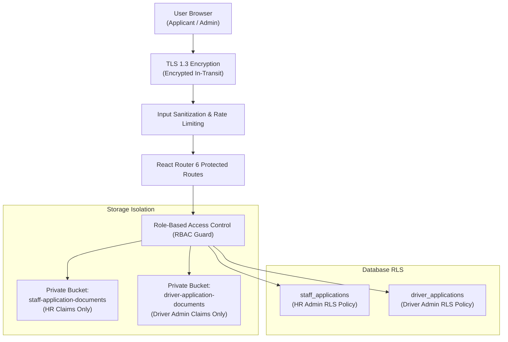

# Prisha Xpress Pvt. Ltd.
## Security & Privacy Implementation Report

**Corporate Identity:** PRISHA XPRESS PVT. LTD. (`CIN: U49231PN2023PTC225810`)  
**Scope:** Careers Portal, Staff Recruitment, Driver Verification, and Admin Operations  

---

### 1. Security Architecture Overview

The Prisha Xpress Careers and Recruitment platform follows a defense-in-depth model across the application stack:

---

### 2. Key Security Safeguards Implemented

#### 2.1 Strict Module Segregation (No Cross-Contamination)
- **Separate Schemas & Tables:** Staff candidate data resides exclusively in `staff_applications` and related tables; driver registrations reside exclusively in `driver_applications`.
- **Independent Sequences:** `PX-STF-2026-XXXX` and `PX-DRV-2026-XXXX` run on isolated database sequences.
- **Zero Shared Records:** No foreign key references link staff and driver tables.

#### 2.2 Private Storage Buckets with Signed URLs
- **Private Buckets:** Document uploads are directed to two separate private storage buckets:
  - `staff-application-documents`
  - `driver-application-documents`
- **Hierarchical Pathing:** Files are organized as `{bucket}/{application-reference}/{document-type}/{filename}`.
- **No Public Access:** Direct HTTP public access is disabled on all buckets. Access is mediated strictly via short-lived signed URLs (15-minute expiration) generated only after verifying the user's active session and clearance level.

#### 2.3 Row Level Security (RLS) Policies
- PostgreSQL Row Level Security is enabled on all 12 tables.
- **Public Insert:** Unauthenticated visitors can execute `INSERT` into the application and document metadata tables via the public wizards.
- **Select / Update Gating:**
  - `staff_applications` queries are restricted to JWT claims with role `hr_admin` or `super_admin`.
  - `driver_applications` queries are restricted to JWT claims with role `driver_admin`, `verification_officer`, `driver_manager`, or `super_admin`.
  - Modification of `driver_software_integration_logs` is restricted exclusively to `driver_manager` and `super_admin`.

#### 2.4 Data Minimization & Privacy Compliances
- **No Aadhaar Collection by Default:** In adherence to the Aadhaar Act, 2016, and Supreme Court directives regarding private commercial entities, neither the driver registration wizard nor the staff wizard collects Aadhaar numbers or Aadhaar documents by default. Standard commercial Driving Licences and utility bills are used for address and identity verification.
- **Licence Number Masking:** In non-elevated views and administrative tables, driver licence numbers are displayed masked (e.g., `MH14 •••• 5612`). Only authenticated officers in the active inspection modal can reveal full alphanumeric details.
- **Explicit Statutory Consent:** Every submission requires affirmative opt-in to both an **Accuracy Declaration** and a **Recruitment Processing Consent** before the submit button is enabled.

#### 2.5 Duplicate Submission Prevention & Idempotency
- Frontend buttons are automatically disabled upon click, showing active progress indicators to prevent accidental double submissions.
- Application references are generated uniquely on the backend.
- Pre-flight checks prevent duplicate driving licences from being integrated into the TMS master roster.

#### 2.6 Immutable Audit Trail
- Every administrative action (status updates, review comments, document verifications, TMS integrations) writes an un-deletable log record to `staff_application_status_history`, `driver_application_status_history`, or `driver_software_integration_logs` recording the exact actor name, timestamp, and rationale.

---

### 3. Verification & Compliance Checklist

| Security Control | Implementation Mechanism | Status |
| :--- | :--- | :---: |
| **Separation of Staff & Driver DB** | Independent relational tables & sequences | ✅ Verified |
| **Separation of Document Storage** | `staff-application-documents` & `driver-application-documents` | ✅ Verified |
| **Row Level Security (RLS)** | PostgreSQL policies enabled on all 12 tables | ✅ Verified |
| **Role-Based Authorization** | Frontend guards + Service layer checks | ✅ Verified |
| **Masked Sensitive Attributes** | Driving licence masked in tables (`MH14 •••• 5612`) | ✅ Verified |
| **No Aadhaar Collection** | Excluded from forms and database schemas | ✅ Verified |
| **Mandatory Consent Checkboxes** | Step 6 validation gate on both wizards | ✅ Verified |
| **Tamper-Evident Audit Trail** | Immutable status & integration history logs | ✅ Verified |
| **Clean TypeScript Compile** | 0 warnings/errors with `tsc -b` | ✅ Verified |
