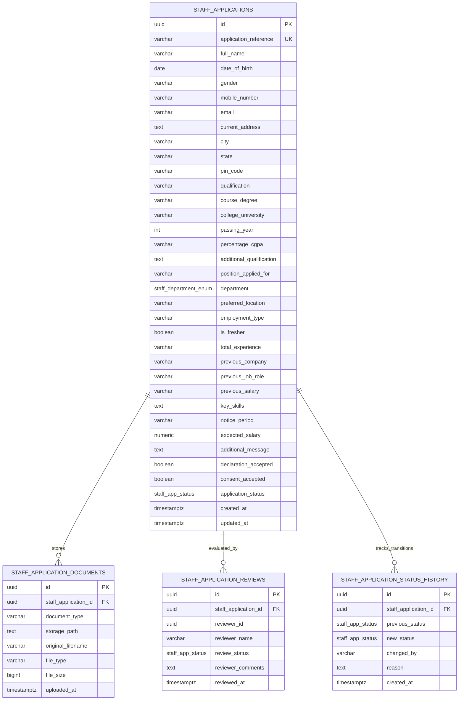

# Prisha Xpress Pvt. Ltd.
## Module A: Staff Recruitment Database Architecture

**Module Scope:** Corporate Staff, Management, Operations, Accounts, IT, and Non-Driver Roles  
**Target Enterprise System:** Corporate HRMS & Payroll Master  
**Reference Format:** `PX-STF-2026-XXXX`  
**Storage Path:** `staff-application-documents/{reference}/`  

---

### 1. Relational Entity Relationship Diagram

---

### 2. Table Specifications

#### 2.1 `staff_applications`
- **`id`** (`UUID`, Primary Key, `DEFAULT uuid_generate_v4()`)
- **`application_reference`** (`VARCHAR(50)`, Unique, Not Null, generated via `staff_app_ref_seq`). Example: `PX-STF-2026-0042`.
- **`full_name`** (`VARCHAR(255)`, Not Null): Legal name of candidate.
- **`date_of_birth`** (`DATE`, Not Null): Date of birth.
- **`gender`** (`VARCHAR(20)`, Not Null): 'Male' | 'Female' | 'Other'.
- **`mobile_number`** (`VARCHAR(20)`, Not Null): Primary contact number.
- **`email`** (`VARCHAR(255)`, Not Null): Primary correspondence email.
- **`current_address`** (`TEXT`, Not Null): Current residential street address.
- **`city`**, **`state`**, **`pin_code`** (`VARCHAR`, Not Null).
- **`qualification`** (`VARCHAR(100)`, Not Null): Highest degree qualification.
- **`course_degree`** (`VARCHAR(200)`, Not Null): Academic course name.
- **`college_university`** (`VARCHAR(255)`, Not Null): Educational institution.
- **`passing_year`** (`INTEGER`, Not Null): Year of graduation.
- **`percentage_cgpa`** (`VARCHAR(20)`, Not Null): Academic grade / percentage.
- **`additional_qualification`** (`TEXT`): Additional certifications.
- **`position_applied_for`** (`VARCHAR(150)`, Not Null).
- **`department`** (`staff_department_enum`, Not Null): 'Administration', 'Human Resources', 'Operations', 'Transport & Logistics', 'Accounts & Finance', 'IT & Technical', 'Other'.
- **`preferred_location`** (`VARCHAR(150)`, Not Null): Pune HQ or regional offices.
- **`employment_type`** (`VARCHAR(50)`, Not Null, Default: `'Full-time'`).
- **`is_fresher`** (`BOOLEAN`, Not Null, Default: `false`).
- **`total_experience`** (`VARCHAR(50)`): Relevant years in logistics/office.
- **`previous_company`**, **`previous_job_role`**, **`previous_salary`** (`VARCHAR`): Work history.
- **`key_skills`** (`TEXT`): ERP software, telematics, dispatch, taxation skills.
- **`notice_period`** (`VARCHAR(50)`): Join timeline.
- **`expected_salary`** (`NUMERIC(12, 2)`): Annual CTC expectation in INR.
- **`additional_message`** (`TEXT`): Candidate remarks.
- **`declaration_accepted`** (`BOOLEAN`, Not Null, Default: `false`): Statutory truthfulness declaration.
- **`consent_accepted`** (`BOOLEAN`, Not Null, Default: `false`): Recruitment data processing agreement.
- **`application_status`** (`staff_app_status`, Not Null, Default: `'Submitted'`):
  - `'Submitted'`
  - `'Under Review'`
  - `'Shortlisted'`
  - `'Interview Scheduled'`
  - `'Selected'`
  - `'Rejected'`
  - `'On Hold'`
- **`created_at`**, **`updated_at`** (`TIMESTAMPTZ`, Not Null, Default: `NOW()`).

#### 2.2 `staff_application_documents`
- **`id`** (`UUID`, Primary Key, `DEFAULT uuid_generate_v4()`)
- **`staff_application_id`** (`UUID`, Foreign Key referencing `staff_applications(id)` on cascade delete)
- **`document_type`** (`VARCHAR(50)`, Not Null): `'resume'`, `'educational_certificate'`, `'experience_certificate'`, `'profile_photograph'`.
- **`storage_path`** (`TEXT`, Not Null): Encrypted path within `staff-application-documents` private bucket.
- **`original_filename`** (`VARCHAR(255)`, Not Null).
- **`file_type`** (`VARCHAR(100)`, Not Null): MIME type (`application/pdf`, etc.).
- **`file_size`** (`BIGINT`, Not Null): File size in bytes.
- **`uploaded_at`** (`TIMESTAMPTZ`, Not Null, Default: `NOW()`).

#### 2.3 `staff_application_reviews`
- **`id`** (`UUID`, Primary Key, `DEFAULT uuid_generate_v4()`)
- **`staff_application_id`** (`UUID`, Foreign Key referencing `staff_applications(id)` on cascade delete)
- **`reviewer_id`** (`UUID`, Not Null): Admin user ID of HR evaluator.
- **`reviewer_name`** (`VARCHAR(255)`, Not Null): Name of HR officer.
- **`review_status`** (`staff_app_status`, Not Null): Evaluation milestone.
- **`reviewer_comments`** (`TEXT`, Not Null): HR assessment notes.
- **`reviewed_at`** (`TIMESTAMPTZ`, Not Null, Default: `NOW()`).

#### 2.4 `staff_application_status_history`
- **`id`** (`UUID`, Primary Key, `DEFAULT uuid_generate_v4()`)
- **`staff_application_id`** (`UUID`, Foreign Key referencing `staff_applications(id)` on cascade delete)
- **`previous_status`**, **`new_status`** (`staff_app_status`, Not Null).
- **`changed_by`** (`VARCHAR(255)`, Not Null).
- **`reason`** (`TEXT`): Formal business explanation for transition.
- **`created_at`** (`TIMESTAMPTZ`, Not Null, Default: `NOW()`).

---

### 3. Row Level Security & Isolation Rules
- **No Cross-Module Foreign Keys:** No table in Module A references any driver table or sequence.
- **Restricted Access:** Select/Update queries permitted exclusively for roles `hr_admin` and `super_admin`.
- **Storage Isolation:** All resumes and degree certificates reside solely in the `staff-application-documents` private storage bucket.
